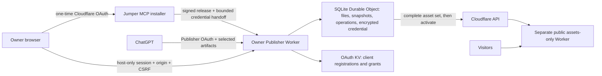

# Jumper Publisher

Ask Claude, ChatGPT or another Ai agent to create a web page. Once done, you receive a public URL where it is hosted.  

Come back weeks later in a new chat to make changes the the website, even in a different AI agent. The website lives in **your own Cloudflare account** (free or paid). **Publisher** is your perfect solution for personal pages and small projects that need to be visible right away.

You already swapped coding for prompting. Publisher drops the next chore: downloading files, finding a host, and uploading again for every small fix.

* **Install now:** [publisher.jumpermcp.dev](https://publisher.jumpermcp.dev/)
* **Docs:** [jumpermcp.dev/publisher/docs](https://jumpermcp.dev/publisher/docs/) 
* **Privacy:** [jumpermcp.dev/publisher/privacy](https://jumpermcp.dev/publisher/privacy/) 
* **Support:** support@jumpermcp.dev
* **Example site:** [pants-math.snlr308.workers.dev](https://pants-math.snlr308.workers.dev/)

<br />


<br />


## What Publisher does

You ask your AI client: *"Create a website about a new science called Pants Math, with a widget where visitors test pants hypotheses, and publish it."* It creates the website, hands it to your Publisher, and replies to you with an address like `https://pants-math.<your-name>.workers.dev`

A month later, in a fresh chat, maybe on your phone, maybe in Claude instead of ChatGPT: *"Make the pants-math background blue."* The AI finds the site, changes only the background, and republishes at the same address. Don't like the background after all? Ask it to undo.

You're cutting out the middleman: No GitHub needed, or other file host, or terminal, or build step, or AI provider API key.

## Videos

| [How to install (one-time)](https://www.youtube.com/watch?v=s7Oz0lrCuuE) | [How to use](https://www.youtube.com/watch?v=P0WYFshgFnc) |
|:-:|:-:|
| [](https://www.youtube.com/watch?v=s7Oz0lrCuuE) | [](https://www.youtube.com/watch?v=P0WYFshgFnc) |


## Screenshots

<table>
<tr>
<td></td>
<td></td>
<td></td>
<td></td>
</tr>
</table>

## What you need

- Cloudflare account, *free or paid*. The Publisher plugin creates Workers and KVs there on your behalf.
- ChatGPT account, *free or paid*. Free accounts first enable "developer mode" (Settings → Security & login).
  - Or a Claude account (web, Desktop, mobile, Claude Code). See [Using Publisher with Claude](#using-publisher-with-claude).
  - Or Codex. See [Using Publisher with Codex](#using-publisher-with-codex).
  - Or any other MCP-capable agent.

## How to install (once)

1. Open [publisher.jumpermcp.dev](https://publisher.jumpermcp.dev/), choose **Install on my Cloudflare**, and sign in to Cloudflare. If you're interrupted, the installer resumes where it stopped.
2. Open the setup link the installer shows you and create your password. The link is single-use and expires quickly, so nobody else can claim your Publisher.
3. In your Publisher's **Settings**, add a Cloudflare API token with **Edit** permission for **Workers Scripts**. The installer walks you through creating it. Paste the Cloudflare API token *only* in the Publisher, never into a chat. This API token connects your Publisher with your Cloudflare. Jumper MCP (from where you started the installer) will not get to know it.
4. Add Publisher to your AI agent, using the *MCP URL* from your Publisher's **AI connections** panel, including `/mcp` at the end. Your agent will prompt you to authenticate, using your owner password. Details below, per agent vendor.

## How to use (daily)

Prompt away to create new websites. Reference your Publisher plugin to have the result published. To find an old website, paste its name, project ID, or URL into any connected AI client. It will use Publisher to find the project, without you having to look for the original conversation. Ask to undo, and the previous version goes back online.

Your Publisher cockpit lists every site. From there you can unpublish (hide), export, delete, and update the Publisher itself. If the agent tries to rewrite far more or far less than you asked for (the classic "rest of the code unchanged"), Publisher flags it instead of publishing. Multiple chats editing the same site can't silently overwrite each other (use case: project open in phone session as well as desktop session).

--- 

## Installation details, per agent

### ChatGPT

The description above and the "daily use" video refer to chatgpt.com. Jumper Publisher is not found in OpenAI's official Plugin Directory. Tools are only accepted there that bring their own 3rd-party URL. However, Jumper Publisher does not direct your data to itself, it sends your data to _your URL_ instead. This is why you are adding your Publisher plugin manually, as shown in the video:

- At chatgpt.com, under Plugins, "Add --> Add Custom MCP Server".
- Provide your `publisher-xyz.xyz.workers.dev/mcp` URL.
- Save and let ChatGPT redirect you to your Publisher.
- Authenticate with your owner password.

### Claude

- Either: **Add Connector:** At [claude.ai](https://claude.ai), open **Settings → Connectors → Add custom connector** and paste the MCP URL from your Publisher's **AI connections** panel. Claude signs in through claude.ai and registers with a client secret. The connector is now also available in Claude Desktop, mobile and Claude Code.
- Or: Install the "Jumper Publisher" plugin via the official Claude Directory (submitted, approval pending).
- Or: **Claude Code CLI with its own connection:** Instead of using claude.ai to create a Connector, you can sign in through `localhost` on your computer: 
  1. Enable this in your Publisher cockpit: **AI connections → AI apps on this computer**. Any program on your computer can ask for access. Approve only sign-ins you just started. Then:
  1. Install the plugin. It adds the connection plus a Skill for publishing, editing, uploads and undo. Paste in your Claude Code CLI: `/plugin install jumper-publisher --marketplace JumperMCP/jumper-publisher`(paste your MCP URL when asked). Then:
  1. `/mcp` to sign in

#### Notes:

- **Images, ZIPs and large files:** 
  - Claude (via claude.ai): only sends text through its tools. For files, it asks your Publisher for a one-time upload link and sends the file there from its code sandbox or shell. The file never passes through the chat (preserving tokens). This needs **Settings → Capabilities → Code execution and file creation** switched _on_, **Allow network egress** _on_, and your Publisher's address under **Additional allowed domains** (your `publisher-….workers.dev` address). 
  - Claude Code CLI: needs nothing extra.
- **Access:** Each sign-in appears under **AI connections → Connected apps** with option to **Revoke**.

### Codex

1. Allow sign-ins from your computer under **AI connections → AI apps on this computer**. Codex signs in through `127.0.0.1` on your computer.
2. `codex mcp add publisher --url <your MCP URL>`
3. `codex mcp login publisher`, then sign in with your Publisher owner password and _approve_.

### Antigravity

Needs Publisher 0.1.23 or later. Antigravity signs in through Google's page, so local sign-in can stay off.

- **Plugin** (adds the `publish-website` skill; Marketplace listing pending): clone this repository, run `agy plugin install ./jumper-publisher/antigravity`, then in the CLI `/plugin` → **jumper-publisher** → **Configure MCP servers** and paste your MCP URL. Open `/mcp`, select **jumper-publisher_mcp** → **Authenticate**, sign in, approve, and paste the code from Google's page back into Antigravity.
- **MCP server only:** `agy mcp add publisher <your MCP URL>`, then `/mcp` → **publisher** → **Authenticate** as above.

### Muse

- Muse does not allow the user to install their own Connectors.  
- Prompt Muse to install Publisher for you. It expects the server address (your `publisher-xyz.xyz.workers.dev/mcp`), and a note that it uses OAuth, and a URL _allow list_ (provide your `publisher-xyz.xyz.workers.dev`)
- Muse installs it as needed, and presents a "Connect" button to you.
- Consider having Muse create a "Skill" named "Publisher", to make it easier to invoke it.

## What Publisher can host

- Finished websites: HTML, CSS, JavaScript, images and other small files, loose or as a ZIP, with an `index.html`. React or Vue sites work if you upload the built output.
- Not supported: databases, large videos, or teams (multi-user per Publisher). 
- Hosting on your own domain: works if you tweak your Cloudflare. Uploaded files are served, never run (affects source code files).
- Limits: **20 websites**, 25 MB each, files up to 10 MB (Cloudflare free plan limit is 100 Workers against max 250 MB). The last 20 versions of each website is kept for _undo_.

## Cost and privacy

- Publisher is free and MIT licensed. 
- Publisher cannot read or edit your billing details. 
- Publisher shares your Cloudflare account's space and compute allowance with your other stuff that runs there.
- Your sites and their traffic never pass through Jumper MCP. Jumper MCP only provides the installer. 
- Existing sites keep working even if the installer goes down.
- Everything you publish is public.
- Your `workers.dev` address may include part of your name or email. This is controlled in your Cloudflare.
- Cloudflare's acceptable-use rules will apply to your site names, account verification, content etc.

## Troubleshooting

- **Name already taken by a previous project:** Your agent asks you for another name.
- **Published but not loading yet:** Try again in a few minutes; the upload itself probably succeeded.
- **Out of space:** You export and delete old sites. Live sites are never removed to make room.
- **Publishing event claims token is missing:** Grab a "Worker Scripts" API token from Cloudflare (permission _edit_), add it in your Publisher settings (step 3).
- Also see: [recovery and uninstall](docs/recovery.md).

---


<details>
<summary>Above comparison in text format, with links: ...</summary>

## How it compares

<sub>✅ yes · 🟡 partly, or with conditions · 🔜 planned · ❌ no</sub>

| | Publish from your AI chat | Hosted in your own account | Quick to set up | Edit from a later chat | Version history / undo | Your own domain | Server code | Database |
|---|:-:|:-:|:-:|:-:|:-:|:-:|:-:|:-:|
| **[Publisher](https://publisher.jumpermcp.dev/)** (this project) | ✅ Claude, ChatGPT + MCP | ✅ Cloudflare | 🟡 one-time install | ✅ | ✅ last 20 | 🟡 manual today ¹ | 🔜 planned ² | ❌ |
| **[WebsitePublisher.ai](https://www.websitepublisher.ai/)** (hosted AI publisher) | ✅ many AI chats | ❌ their platform | ✅ sign in | ✅ | ✅ count by plan | 🟡 paid plans | 🟡 built-in only | ✅ |
| **[ChatGPT Sites](https://help.openai.com/en/articles/20001339-creating-and-using-chatgpt-sites)** (paid plans, private or public) | ✅ ChatGPT only ⁴ | ❌ OpenAI | ✅ none | ✅ | ✅ saved versions | ✅ | 🟡 JS/TS only | ✅ |
| **[Claude artifact](https://support.claude.com/en/articles/9547008-publish-and-share-artifacts)** (published link) | ✅ Claude only | ❌ claude.ai | ✅ none | 🟡 original chat | 🟡 | ❌ | 🟡 AI calls only | 🟡 paid plans, 20 MB |
| **[Netlify Drop](https://app.netlify.com/drop)** (drag and drop) | ❌ manual | ✅ once claimed ³ | ✅ none | ❌ re-upload | ✅ | ✅ | 🟡 not via Drop | 🟡 not via Drop |
| **[Cloudflare upload](https://developers.cloudflare.com/pages/get-started/direct-upload/)** (dashboard direct upload) | ❌ manual | ✅ Cloudflare | ✅ dashboard | ❌ re-upload | ✅ | ✅ | 🟡 not via upload | 🟡 not via upload |
| **[Git-based hosting](https://developers.cloudflare.com/pages/configuration/git-integration/)** (GitHub Pages, Cloudflare, Netlify) | 🟡 repo-editing AI | 🟡 repo on GitHub | ❌ Git know-how | 🟡 via the repo | ✅ full history | ✅ | 🟡 depends on host | 🟡 depends on host |
| **[AI app builders](https://docs.lovable.dev/features/custom-domain)** (Lovable, Bolt, v0) | 🟡 their own chat | ❌ mostly theirs | ✅ sign up | ✅ in their editor | ✅ | 🟡 paid plans | ✅ | ✅ |
| **[Netlify MCP server](https://github.com/netlify/netlify-mcp)** (for coding tools) | 🟡 coding tools | ✅ Netlify | ❌ developer setup | 🟡 | ✅ | ✅ | ✅ | 🟡 |

<sub>¹ Attach a domain to the site's Worker in Cloudflare (Settings → Domains & Routes); the domain must be on Cloudflare. Doing this from the chat is planned.</sub><br>
<sub>² Sites are static today. Server code needs a chosen runtime, so it was left out of v1 and is planned. No database support.</sub><br>
<sub>³ Unclaimed Netlify Drop sites are deleted within an hour.</sub><br>
<sub>⁴ Workspace admins on Business and Enterprise can restrict publishing; Enterprise turns public publishing off by default.</sub><br>

</details>

---

# Details

## Verification

Current release 0.1.12 was signed and served from the installer domain ([release notes](docs/release-notes.md)). An independent tester on a separate Cloudflare account completed installation, owner setup, ChatGPT connection, publishing, and discovery plus editing from an unrelated smartphone session, and updated through several releases. Not yet measured: file and generated-image transfer from ChatGPT attachments, Cloudflare OAuth refresh (hence the API token in setup step 3), and free-plan CPU and memory under the maximum limits. Details: [acceptance ledger](docs/acceptance.md). To run your own installer: [operator runbook](docs/operator-setup.md).

## Architecture



Snapshots save to SQLite-backed Durable Object. KV holds only OAuth records. Each site is a separate assets-only Worker without Publisher credentials or bindings. Content and visitor traffic do not pass through the installer. Ordinary publishing does not call it. Revoking the Cloudflare OAuth app is different from installer downtime and can require reconnecting.

## Limits and serving rules

| Limit | Value |
| --- | --- |
| Projects / files per project | 20 / 100 |
| Uncompressed project / single file | 25 MiB / 10 MiB |
| Retained content incl. staging | 250 MiB, deduplicated |
| Publication history | Latest 20 successful snapshots |
| Abandoned candidate lifetime | 24 hours |
| Inline text per file / MCP request body | 256 KiB / 1 MiB |
| Text response | 16,000 characters, with continuation |

Static routing by default. `404.html` enables 404 behavior. SPA fallback must be explicit. `_headers` (relative paths) and `_redirects` (up to 100 relative-source rules) are validated and passed as direct-upload config, and kept in snapshots and exports. Unsupported syntax and `.assetsignore` are rejected.

## Security model

Report vulnerabilities privately; see [SECURITY.md](SECURITY.md).

- **Two separate authorizations.** Cloudflare authorization lets the Publisher deploy; Publisher OAuth lets ChatGPT reach projects. The [installer](src/installer/worker.ts) uses public-client PKCE S256, checks required scopes before provisioning, never asks for token-creation rights, and erases its temporary credential after handoff or a one-hour expiry. Publishing then uses an account-scoped API token the owner enters on their own Publisher; OAuth refresh handoff stays off until it is verified.
- **Owner access** ([security.ts](src/security.ts)): single-use setup token, salted PBKDF2, throttling, expiring `__Host-` cookies, exact-origin and CSRF checks on writes (sibling sites are same-site). Credentials are AES-GCM encrypted with a key in Worker secrets; refreshes are serialized, replacements stored before use, and an interrupted rotation asks you to reconnect. Recovery invalidates sessions and MCP grants. Encryption at rest won't help against malicious Publisher code or a compromised account.
- **ChatGPT access** ([oauth-policy.ts](src/oauth-policy.ts)): exact configured callbacks and public clients only; consent shows the self-reported client and the real callback. The provider validates PKCE and token audience; handlers enforce scope and the owner epoch. CIMD is off until needed. An allowlist alone doesn't prove client identity.
- **Files** ([files.ts](src/files.ts)): operator-approved HTTPS hosts only (the list starts empty), redirects revalidated, deadlines and streaming byte limits. ZIPs: bounded expansion; traversal, symlinks, encryption, duplicate paths and build inputs rejected. Missing or expired references return an attach/export instruction, and binary assets leave via ZIP export rather than oversized tool output. Retrieved text is untrusted; MCP annotations guide the model but are no prompt-injection defense. Provider errors are sanitized; credentials and signed URLs are never logged.

## Data integrity

MCP and the owner UI share one [project layer](src/projects.ts). [Storage](src/store.ts) keeps immutable SHA-256-addressed 512 KiB chunks; a revision captures files and serving settings together, and capacity is checked inside the transaction. Patches apply only if every old string matches exactly once. Candidate revisions stay private until published, and a combined stage-and-publish call is deduplicated by a payload-bound request key. [Publication](src/cloudflare.ts) is serialized per project, rechecks its base revision, uploads all assets before activating, records version and deployment IDs, resumes via Durable Object alarms (closing the chat doesn't cancel it), and reconciles lost activation responses rather than reporting false failures. Cleanup never touches the live publication, retained history, or active operations. Confirmed deletion removes the installation-owned deployment and its stored files. Export links are five-minute bearer links: anyone holding one can download until it expires.

## Updates and supply chain

[Releases](src/releases.ts) are checked against an Ed25519 trust root, module checksums, compatibility, migration tag and class identity. [Owner-approved updates](src/updates.ts) persist before upload, re-verify the stored bundle, keep bindings and secrets, never replay creation migrations, and leave site content alone. The updater currently accepts schema/tag v1 only. Releases require a clean committed source tree, with pinned and locked dependencies. The release signer and installer remain trusted parties. A valid signature doesn't prove safety or what a hosted installer deployed; compare deployed modules with the numbered release, or have an agent audit the source before installing. Code rollback doesn't undo database changes, so keep a known-good release.

## Operation states worth knowing

- **Conflict:** the project moved on; read the latest revision and stage the change against it.
- **Rewrite warning:** read the candidate and clarify intent before acknowledging. Bytes are never silently repaired.
- **Authorization or rotation failure:** reconnect Cloudflare in the owner UI, keeping the original encryption key.
- **Activated, awaiting reachability:** the deployment is live on Cloudflare's side; retry the address later.

## Development

Node.js 24 or newer:

```sh
npm ci
npm run check
npm run build      # dry run, not a deployment
npm test
npm run format:check
```

Runtime tests need local workerd and loopback sockets. On NixOS set `MINIFLARE_WORKERD_PATH` to a compatible launcher, since the npm workerd binary expects the standard Linux dynamic linker; in restricted environments set `WRANGLER_LOG_PATH`. Use your own `wrangler.jsonc` copy, OAuth KV namespace, and secrets (ignored `.dev.vars` or Wrangler secrets); never deploy the placeholder config. The installer builds from `wrangler.installer.jsonc` (`npm run build:installer`, also a dry run). The [operator runbook](docs/operator-setup.md) lists every required setting, the public OAuth client setup, release signing, and scope verification.

Tests: [projects](tests/projects.test.ts), [runtime/OAuth/MCP](tests/runtime.test.ts), [security](tests/security.test.ts), [files](tests/files.test.ts), [releases](tests/releases.test.ts).

Take a peek at QUIRKS.md (running log of noteworthy issues).

---

Built by [Jumper MCP](https://jumpermcp.dev/)
